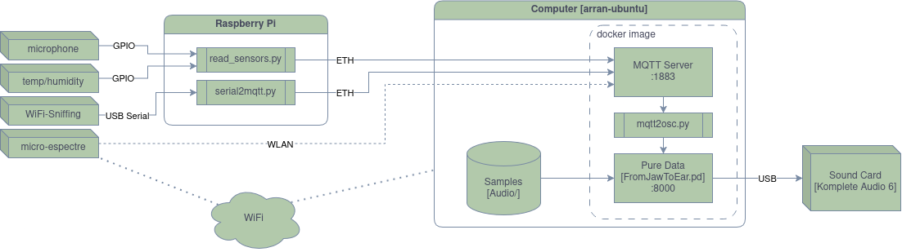

# From Jaw to Ear — From Bone to Signal Deployment

Containers and files to build and launch [Natalia
Jordanova](https://nataliajordanova.com)'s _From Jaw to Ear — From Bone to
Signal_ installation.

Not (yet) included in the repo:

- `pd/Audio/`: directory of source audio recordings (speech, foley, noises etc)
- `pd/alldata*.txt`: sensor traces. Will be generated by `FromJawToEar.pd` as
  sensor data is sent to the MQTT server.
- Embedded system code for ESP32s.
- RaspberryPi scripts

## Requirements

- A USB sound card connected to main computer (so `pd -audiodev 2` resolves to
  an output device), otherwise there is no sound.
- An internet connection on first build to install dependencies

## To start

```sh
# on the main computer
docker compose up -d --build
```

## Architecture


